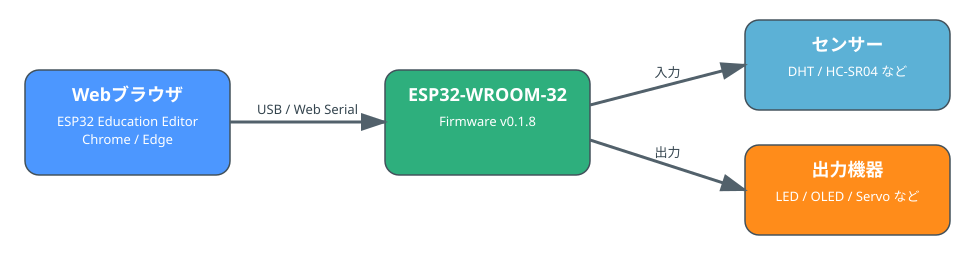
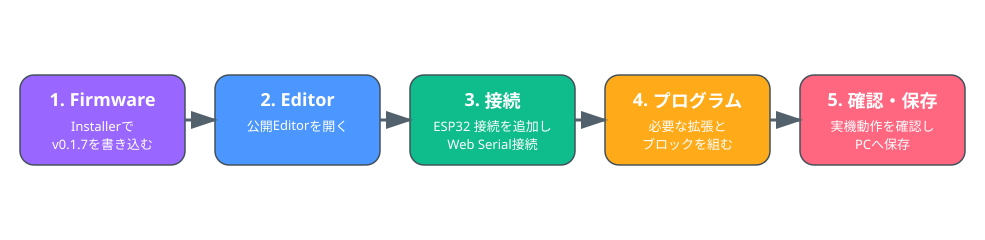
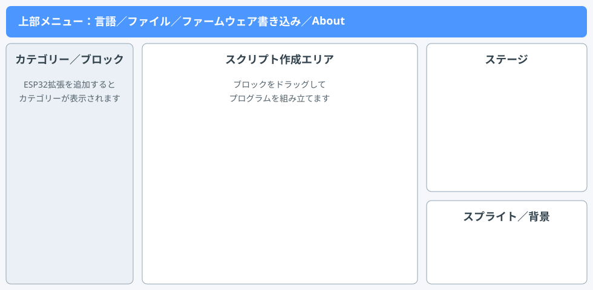

# ESP32 Education Editor ユーザーズガイド

[マニュアル一覧](MANUAL_INDEX_JA.md) | [ブロックリファレンス](BLOCK_REFERENCE_JA.md)

## 1. ESP32 Education Editorとは

ESP32 Education Editorは、ESP32-WROOM-32をブラウザからブロックで操作する教育向けプログラミング環境です。ESP32側にはFirmware v0.1.8を書き込み、EditorからUSB / Web Serialで命令を送ります。

- Editor: **v0.6**
- Firmware: **v0.1.7**
- 対象ボード: **ESP32-WROOM-32 / ESP32 Dev Module**
- 公開Editor: <https://davinichi.github.io/>
- Firmware Installer: <https://davinichi.github.io/firmware/>

## 2. 必要なもの

- ESP32-WROOM-32
- データ通信可能なUSBケーブル
- ChromeまたはEdgeなどWeb Serial対応ブラウザ
- インターネット接続（公開Editor・Installerの読み込み時）
- 使用するセンサー、LED、OLED、サーボモーターなど
- 回路に応じた抵抗や電源

> HC-SR04のECHO出力は約5Vです。ESP32へ直接入力せず、3.3V以下へ下げてください。

## 3. 初回準備

### 3.1 Firmwareを書き込む

1. ESP32-WROOM-32をUSBでPCへ接続します。
2. [Firmware Installer](https://davinichi.github.io/firmware/)を開きます。
3. 「ESP32に接続して v0.1.7 を書き込む」を押します。
4. ESP32のUSBシリアルポートを選びます。
5. 画面の案内に従って書き込みます。

Arduino IDEや追加ライブラリを利用者側で準備する必要はありません。

### 3.2 Editorを開く

[公開Editor](https://davinichi.github.io/)をChromeまたはEdgeで開きます。上部の言語メニューから日本語／Englishを切り替えられます。

## 4. 画面構成

- **上部メニュー**: 言語切替、ファイル、新規作成、保存・読み込み、Firmware Installer、About
- **カテゴリー／ブロック**: 標準カテゴリーと追加したESP32拡張
- **スクリプト作成エリア**: ブロックを組み立てる場所
- **ステージ**: スプライトの表示と実行結果の確認
- **スプライト／背景**: スプライトや背景の追加・選択

## 5. ESP32へ接続する

1. 画面左下の拡張機能ボタンを押します。
2. **ESP32 接続**を追加します。
3. 「ESP32に接続」ブロックを実行します。
4. 表示された一覧からESP32のシリアルポートを選びます。
5. 必要に応じて「ESP32の状態を更新」を実行し、状態・MACアドレス・チャンネルを確認します。

同じシリアルポートをArduino IDEのシリアルモニターなどが使用している場合は、先に切断してください。

## 6. 拡張カテゴリーを追加する

利用目的に応じて拡張カテゴリーを追加します。

| カテゴリー | 主な用途 | ESP32接続 |
|---|---|---|
| ESP32 接続 | 接続、状態、MAC、チャンネル | 必要 |
| ESP32 GPIO | デジタル入出力、PWM | 必要 |
| ESP32 DHT | DHT11 / DHT22温湿度 | 必要 |
| ESP32 OLED | SSD1306 OLED表示 | 必要 |
| ESP32 ESP-NOW | ESP32間の文字列通信 | 必要 |
| ESP32 Servo | サーボモーター | 必要 |
| ESP32 超音波 | HC-SR04距離測定 | 必要 |
| ESP32 環境指数 | 10種類の環境指数計算 | 不要 |
| データ処理 | CSV・文字列処理 | 不要 |

各ブロックの詳細は[ブロックリファレンス](BLOCK_REFERENCE_JA.md)を参照してください。

## 7. 基本的なプログラムの作り方

### 7.1 LEDを点灯する例

1. ESP32 接続を追加し、ESP32へ接続します。
2. ESP32 GPIOを追加します。
3. 「GPIO 23 を 出力 に設定」を実行します。
4. 「GPIO 23 に HIGH を出力」で点灯します。
5. 「GPIO 23 に LOW を出力」で消灯します。

LEDには電流制限抵抗を使用し、配線を確認してください。

### 7.2 センサー値を表示する例

1. DHTセンサーを初期化します。
2. DHT温度とDHT湿度を読みます。
3. OLEDを初期化します。
4. カーソル位置と文字サイズを設定します。
5. 取得値を文字列にしてOLEDへ表示します。

## 8. プログラムの実行

Scratch標準のイベントブロックや制御ブロックと、ESP32拡張ブロックを組み合わせます。

- 緑の旗が押されたとき
- ずっと
- ○秒待つ
- もし～なら
- ○回繰り返す
- 変数・演算

現在のEditorはLive型です。プログラム実行中はPC、ブラウザ、USB接続が必要です。

## 9. プロジェクトの保存と読み込み

上部の**ファイル**メニューから操作します。

- **新規**: 新しいプロジェクトを開始
- **コンピューターから読み込む**: 保存済みプロジェクトを開く
- **コンピューターに保存する**: 現在のプロジェクトをPCへ保存

日本語表示と英語表示では内部のextension ID・opcodeを共通化しているため、同じプロジェクトを両言語で開けるよう設計されています。

## 10. ESP-NOWの利用

ESP-NOWはESP32同士が直接通信する仕組みです。

- 学校Wi-Fiアクセスポイント: 不要
- 校内LAN: 不要
- ESP-NOW通信時のインターネット: 不要
- 送受信するESP32のチャンネル: 同じ値に設定
- MAC空欄の送信: ブロードキャスト
- MAC指定の送信: ユニキャスト

公開EditorやFirmware InstallerをWebから読み込む際はインターネット接続が必要です。

## 11. ハードウェア利用上の注意

- 対象はESP32-WROOM-32です。
- GPIO番号、電源電圧、入力専用ピンなどは使用するボードの仕様を確認してください。
- LEDには電流制限抵抗を使用します。
- サーボモーターの電源条件は使用する製品の仕様を確認します。
- HC-SR04のECHOは3.3V以下へ下げます。
- 配線変更時は必要に応じて電源やUSBを外します。
- 同じGPIOを複数の機能で同時使用しないようにします。

## 12. 困ったとき

最初に次を確認してください。

1. 対象ボードがESP32-WROOM-32か
2. Firmware v0.1.8を書き込んだか
3. Chrome / Edgeを使っているか
4. データ通信可能なUSBケーブルか
5. シリアルポートを他アプリが使用していないか
6. 使用する拡張を追加したか
7. センサーの種類、GPIO、配線、電源が正しいか

詳細は[FAQ / トラブルシューティング](FAQ_JA.md)を参照してください。

## 13. 関連文書

- [ブロックリファレンス](BLOCK_REFERENCE_JA.md)
- [Getting Started](GETTING_STARTED_JA.md)
- [FAQ / トラブルシューティング](FAQ_JA.md)
- [Firmwareガイド](FIRMWARE_GUIDE_JA.md)
- [授業・教育利用ガイド](LESSON_GUIDE_JA.md)
- [バックアップ・レストア手順書](BACKUP_RESTORE_GUIDE_JA.md)

## 14. 位置づけ

ESP32 Education EditorはScratch Foundationが公開するオープンソースのScratch Editorを基にした独立プロジェクトです。Scratch Foundationの公式製品、承認、推奨、スポンサーを意味するものではありません。
